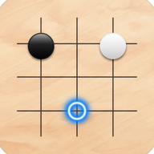

# TuxunGo

**A free, open-source Android Go app powered by KataGo — games and analysis run fully offline**

English | [简体中文](README.md)

No accounts, no ads, no network needed: play against the AI, watch AI
vs AI games, or play a friend on the same phone.

**[Download the latest release](https://github.com/liyuzhou79-star/TuxunGo/releases/latest)** (Android 10+, arm64)

## Features

### Play

- **Three modes**: human vs AI, AI vs AI, human vs human (same device)
- **AI hosting**: hand either color — or both — to the AI at any moment, each side with its **own model and strength** (e.g. the light model on one side, the strong model on the other), switchable mid-game
- **Human-like play**: a per-side switch in the AI hosting panel. Move choices come from a model trained on human game records, in the style of a top human player, while the strong search vetoes outright blunders — it plays like a human, but never deliberately plays a bad move, and its thinking strength is not reduced
- **AI rank capping**: cap the AI anywhere from 18 kyu to 9 dan (or Max for full strength). Capped play imitates a model trained on human games of that rank — it makes the mistakes that rank makes, rather than a strong engine pretending to be weak — for evenly matched practice, in human-vs-AI and AI-vs-AI (each side capped separately)
- **Free-form boards**: 5–25 points per side, rectangular boards included; handicap and komi are free numeric inputs
- **Position editor**: set up any position by hand, then start from it with either color
- **Fullscreen mode**: board at maximum size with just analysis controls — ideal for spectating AI games
- **Game clock & move times**: five clock options (5/10/20/30/60 minutes) plus byoyomi, pausable, timeout loses; the status line shows how long the AI thought about each move, so model and strength changes are easy to compare
- **Focus mode**: one tap hides the win rate, top-move hints and position judgment, leaving just the board — background analysis keeps running, so the post-game review is unaffected
- **One-colour Go**: both sides' stones render black, so the game is played from memory; peek at the true colours any time from the top bar
- **Continuous analysis**: a switch in the analysis panel analyzes every new position automatically, with a one-sentence plain-language commentary
- **Data backup**: export the game library, training progress and settings to a single file, and restore it after a reinstall or on a new phone; Settings also shows the library's game count and storage use at a glance
- **Move numbers**: optionally draw each stone's move number on the board (in Settings)
- **Physical-board clock**: two players on a real board can use the phone as the clock: tap your side after moving, with sound and vibration cues for byoyomi
- **Endgame scoring**: the engine proposes dead stones (marked with red crosses), tap whole groups to flip them, then confirm the score

### Analysis & review

- **AI analysis**: candidate moves ranked on the board with the top choice unmistakable; win-rate bar, score lead, territory estimate, principal-variation ghosts; switchable depth (quick / standard / deep)
- **Position judgment**: one tap for territory, dead stones and a verdict
- **Smart referee & AI resignation**: turn the referee on and a fully settled game is scored automatically; a hopeless AI may offer to resign, but only with your consent
- **Full-game review**: per-move win-rate and score-lead chart with scrubbable replay; **blunders, brilliant moves and the single biggest swing** are marked automatically (a brilliant move must clearly outrun the runner-up — no spam); stretches above 75% win rate are shaded green; black/white perspective switch; at any move the board also draws the top choice's continuation as ghost stones; continue the game from any move; quick / precise / high-precision fill options; any move can also pull up its **territory-ownership map**, and positions you have viewed are cached, so revisiting them is instant
- **Spectating & trend**: a live **mini trend chart** sits above the board during a game (tap it for the full chart); AI-vs-AI exhibition games get a move-by-move **commentary feed** (move, both win rates, turning-point flags, the series score pinned on top) that can be shared as text in one tap; ranked games end with a **rank report**, the AI's rank is printed right on its player card, and your career page (tap the mascot on the home screen five times) keeps your per-rank record against the AI, totals and best rank beaten included
- **Background pre-computation**: while you play, every position's stats are quietly recorded — the post-game review opens (nearly) instantly
- **Annotated SGF export**: copy a review as SGF with per-move win-rate comments
- **Position image sharing**: turn the current board — in a game, in review, in a branch, even at the result dialog — into a picture and share it in one tap

### Training

- **Tsumego training**: eight problems (capturing race, double atari, shared-liberty fight, big-dragon squeeze, ladder, making life, the classic under-the-stones, and the vital-point kill) with difficulty labels — play the right move and the opponent answers automatically, with hints, explanations, solve timing and mistake counts; stuck? Watch the **solution demo** (watching never counts as solving — you still have to play it yourself); a picker list jumps straight to any problem; every solution is verified move by move against the rules; the home screen recommends a daily problem from the unsolved ones; there is also a **timed challenge**: all problems in random order, 90 seconds each, your best score kept, and a one-tap rematch when the run ends
- **Guess-the-move training**: an AI self-play game advances one move at a time and you guess KataGo's top choice, with scoring, streaks and adjustable difficulty; the reveal also draws the top choice's continuation on the board; outright misses are saved to a **mistake book** you can review position by position until you nail them; questions can also be drawn from **your own saved games**: a random mid-game position from your library, and you guess the AI's top choice there

### Game library

- Folders for your saved games: AI games, human games and custom-setup games alike, each with a final-position thumbnail; searchable by title and filterable by type (vs AI / two-player / exhibition) and result (Black won / White won); thumbnails render in the background, so the list scrolls smoothly; long-press any game to jump straight into multi-select; the current game's SGF can be copied to the clipboard mid-game, too
- Finished games are auto-saved to an "Auto-saved" folder, so a game is never lost for forgetting to collect it
- Tap any record to review it; analysis results are cached; in review you can branch off and try alternative lines, analyse the branch, or save it as a new record
- Export the whole library as a single SGF file in one tap — handy for backups, a new phone, or sharing with a friend
- **SGF import**: bring SGF records in from a file or the clipboard (multi-game files, handicap games, setup positions and rectangular boards supported; variations follow the main line), and review games from other platforms — or professional games — with the AI

### Model library

- Ships with two models ready out of the box: a **light model** (fast, plenty for everyday games and analysis) and the human-style model that powers Human-like play. The **strong model** (stronger play and more reliable position judgment, a little slower to think) is a free on-demand download (~98 MB) from the model library instead of bundle weight — and every model, bundled ones included, can be deleted to free space (bundled ones restore for free)
- Import your own KataGo models (`.txt.gz` / `.bin.gz`, up to 99): integrity check, header parse and a real engine test-load — a broken file never enters the library
- Every model, including the built-in one, can be given a nickname — right at import time, too
- Every model can be speed-tested (visits per second) right in the library; results are kept, so they are still there next visit

### Experience

- Real recorded stone sounds (synthesized alternatives included), placement vibration, six board skins (including the pale Moon stone and the dark Obsidian slate), and three theme accents (sakura pink / matcha green / indigo) switchable instantly
- A "My data" page: game totals, black/white win split, recent game lengths and training progress, all computed on-device
- Player cards above the board show who plays each side, captures and each side's clock; the side to move is highlighted
- Games survive backgrounding and process death — pick up right where you left off; if the engine process dies mid-game it restarts and retries the move automatically
- Full-screen gesture navigation support: content keeps clear of the status bar, gesture bar and camera cutouts
- A seven-page first-launch guide, including a page on reading position judgments (reopenable any time from the home footer); long-pressing the launcher icon offers Quick game, Guess the move and Daily problem shortcuts
- **Offline by design**: engine and models live on the device; no server, no account. The only network features are the ones you trigger yourself — "Check for updates" in Settings and the strong-model download in the model library; nothing connects unless you tap it

## Download

Grab the latest release APK from [Releases](https://github.com/liyuzhou79-star/TuxunGo/releases) (Android 10+, arm64).

> Upgrading from an early test build (test signing) to a formal release requires one uninstall first (the signing key differs); export a backup in Settings first and restore it afterwards. Every formal release after that upgrades in place.

## Stronger models (optional)

The downloadable strong model is already very capable. For even more strength, download a net from the [official KataGo model library](https://katagotraining.org/networks/) and import it:

| Model | Size | Notes |
| --- | --- | --- |
| kata1-b28c512nbt | ~259 MB | Among the strongest mainstream nets; slower thinking on a phone |

Import the `.bin.gz` file in the app's model library, give it a name, then assign it to a side in the AI hosting panel and raise its strength.

> Do not download the newer `tf3` architecture nets — this engine version cannot load them, and the importer will reject them.

## Design principles

- Simple pages, no decorative clutter
- Ready out of the box: light and human-style models are bundled; the strong model downloads on demand so the package stays lean; even bigger nets are user-added
- Offline first, always

## Tech

- Kotlin + Jetpack Compose + Material 3
- [KataGo](https://github.com/lightvector/KataGo) v1.15.3 (MIT) compiled with the NDK, driven over GTP and the analysis protocol
- Pure-Kotlin rules engine (captures, suicide ban, positional superko, Chinese scoring) with unit tests

## Contributing

Start with the [code map](docs/CODE_MAP.md): what every file owns and where to look first when changing a feature, all on one page.

## Credits

- [KataGo](https://github.com/lightvector/KataGo) — engine and official models
- [Sabaki](https://github.com/SabakiHQ/Sabaki) — the "real recording" sound set (MIT, see [THIRD_PARTY_NOTICES.md](THIRD_PARTY_NOTICES.md))

## License

GPLv3, see [LICENSE](LICENSE). The KataGo engine and model files follow their own licenses.
