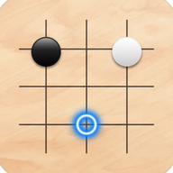

# TuxunGo

**免费、开源的 Android 围棋应用，内置 KataGo 引擎，对局与分析完全离线**

[English](README.en.md) | 简体中文

不用注册、没有广告、不用联网：装上就能和 AI 下棋、看 AI 对弈，
也能和朋友在同一台手机上对局。

**[下载最新正式版](https://github.com/liyuzhou79-star/TuxunGo/releases/latest)**（Android 10+，arm64）

## 功能

### 对弈

- **三种模式**：人对 AI、AI 对 AI、人对人（同机双人）
- **AI 托管**：任何对局中随时呼叫 AI 接管黑方或白方；双方可以各用**不同的模型、不同的强度**对打（比如一边用轻量模型、一边用强力模型），局内随时切换
- **模拟人类落子**：AI 托管面板里可为任意一方打开。落子选点改用专门学习真人棋谱的模型，风格像真人高手，同时有强力搜索兜底——像人，但不会故意下错招，思考强度也不打折
- **AI 棋力定级**：可以把 AI 定在 18 级到 9 段之间的任意一级（再往上是 Max 全部实力）。定级用的是按各级别真人棋谱训练的模型，会犯那个级别常犯的错，不是故意乱下，陪练更对等；人对 AI 和 AI 对 AI（双方分别定级）都支持
- **高自由度棋盘**：5–25 路任意宽高（矩形盘也可以），让子数和贴目都能自由填写
- **摆棋**：自由摆放棋子设定局面，再选任意一方开局
- **全屏模式**：棋盘放到最大，只留分析和形势判断，适合观战 AI 对决
- **双方信息卡**：棋盘上方是黑白双方的卡片（谁执子、提子数、各自剩余时间），轮到谁谁高亮，AI 思考和读秒都有醒目提示
- **棋钟与用时**：5/10/20/30/60 分钟五档加读秒，可暂停、超时判负；AI 每落一手都会显示它这手想了多久，换模型调强度时一目了然
- **专注模式**：一键隐藏胜率、一选提示和形势分析，只剩棋盘和棋子；后台分析照常进行，终局复盘不受影响
- **一色棋**：双方棋子都显示黑色，全靠记忆下棋，练记谱和棋感；顶栏随时可以「显色」偷看一眼
- **连续分析**：AI 分析面板有「连续分析」开关，打开后每落一子自动分析新局面；分析结果带一句话讲棋
- **数据备份**：棋谱库、训练进度和设置可打包导出成一个文件，重装或换手机后导入恢复
- **手数显示**：可在设置里打开，在棋子上标出每一手是第几手落的
- **实体棋盘棋钟**：两个人用真棋盘下棋时，手机可以当棋钟：下完一步点自己这边，读秒提醒带声音和震动
- **终局数目**：引擎判死子按整块棋一起判，红叉标出，你可以点棋块整块改判，确认后再数目

### 分析与复盘

- **AI 分析**：候选着点按优劣标在棋盘上，一选最醒目；胜率条、目差、地盘估算一应俱全，还有 PV 变化图；分析深度可切换（快速 / 标准 / 深度），赶时间还是求精确自己选
- **形势判断**：独立按钮，一键给出地盘、死子和结论
- **智能裁判与 AI 认输**：开启智能裁判后，局面完全收官时裁判自动判定胜负；AI 在绝境时会提出认输，但要先征得你同意
- **对局复盘**：整场逐手胜率与目差曲线，拖动回放每一手；自动标出**恶手、妙手和全场波动最大的一手**（妙手要明显甩开其他候选才算，不刷屏）；一方胜率超过 75% 的时段在图上用绿色标出；黑白视角随时切换；翻到任意一手，棋盘上还会用虚影画出 AI 一选的后续变化；还能从任意一手「继续下」；整场补算有快速 / 精准 / 高精度三档
- **对局时后台预计算**：你下棋的时候，每一手的胜率数据已经在后台悄悄算好——终局打开复盘基本是秒开
- **带解说棋谱导出**：复盘可导出带逐手胜率注释的 SGF，粘贴到任何棋谱软件都能看
- **局面图分享**：对局、复盘、试下分支乃至终局结算时，都可把当前局面生成图片，一键分享给朋友讨论

### 训练

- **死活题训练**：紧气、双吃、共气对杀、大龙紧气、征子、做活、倒脱靴、点眼杀共 8 题（带难度标注），做对一步对方自动应招，带提示和讲解，还有解题计时与错误计数；卡住时可看**正解演示**（看演示不算解开，还是要亲手走对）；选题列表一键跳题；每道题的解法都经过规则推演逐手验证；主页每天推荐一道未解的「每日一题」，点开直达
- **猜一选训练**：AI 自对弈逐手推进，你来猜每一步的 AI 一选，猜中得分、连对有纪录，难度（快速 / 标准 / 深度）可调；揭晓后棋盘上会画出一选的后续变化；没猜中的题会自动收进**错题本**，可以逐题复习，猜中一选才移出

### 棋谱库

- 建文件夹收藏对局：AI 对局、双人对局、摆棋局都能存，可按标题搜索
- 对局结束会自动存一份到「自动保存」，不会因为忘了点收藏而丢棋
- 点开任意棋谱直接进复盘，分析结果会缓存，下次打开秒看；复盘时还能「试下」分支探索不同下法，分支可单独分析、也可存为新棋谱
- 一键把全部棋谱导出成一个 SGF 文件，备份、换手机、发给朋友都方便

### 模型库

- 内置两个模型，开箱即用：**轻量模型**（速度快，日常对局和分析都够用）和真人风格模型（供「模拟人类落子」使用）；**强力模型**（棋力更强，形势判断更准，思考稍慢）改为在模型库里免费按需下载（约 98 MB），不下也不影响使用。所有模型都能在模型库里删除腾空间（内置的删除后可免费恢复）
- 可导入自己的 KataGo 模型（`.txt.gz` / `.bin.gz` 都支持，最多 99 个）：导入时自动校验完整性、解析结构、再用引擎实测加载，坏文件进不了库
- 所有模型（包括内置的）都能改昵称；导入时就能起名
- 每个模型都能测速（每秒访问量），导入大模型前先看看在你的手机上跑多快；测速结果会保存，下次打开直接看

### 体验

- 真实录音的落子/提子音效（另有合成音可选）、落子震动、六款棋盘皮肤（含清爽的「月白石」和深色的「玄黑石墨」）、三种主题色（樱花粉 / 抹茶绿 / 靛蓝）即时切换
- **我的数据**：对局总览、黑白胜负分布、最近对局手数图和训练进度，都在本机统计
- 对局自动保存进度：切到后台、甚至应用被系统杀掉，回来接着下；对局中引擎进程意外退出会自动重启并重试这一步，不丢局
- 全面屏手势导航适配：内容自动避开状态栏、手势条和挖孔
- 首次打开有三页新手指南（主页底部可随时重看）；长按桌面图标有「快速对局」「猜一选」「每日一题」三个快捷入口
- **对局完全离线**：引擎和模型都在手机里，没有服务器、没有账号；唯一的联网功能是设置里手动点的「检查更新」，不点就不联网

## 下载与安装

到 [Releases](https://github.com/liyuzhou79-star/TuxunGo/releases) 下载最新正式版的 APK 安装（Android 10 及以上，arm64）。

> 从早期测试版（测试签名）升级到正式版时，因为签名不同，需要先卸载再安装一次；卸载前可在 App 设置里导出备份，装好后导入恢复。正式版之后的所有版本都可以直接覆盖升级。

## 导入更强的模型（可选）

可下载的强力模型棋力已经很强。想要更强的，可以在 [KataGo 官方模型库](https://katagotraining.org/networks/) 下载后导入，推荐：

| 模型 | 大小 | 说明 |
| --- | --- | --- |
| kata1-b28c512nbt | 约 259 MB | 主流模型里最强之一，手机上思考会慢一些 |

下载 `.bin.gz` 文件后，在 App 的「模型库」里上传、起个名字即可；再到对局里的「AI 托管」面板给某一方换上它、把强度调高。

> 注意：不要下载 `tf3` 开头的新架构模型，当前引擎版本加载不了，导入时会被校验拦下。

## 设计原则

- 页面简洁，不堆花哨装饰
- 开箱即用：轻量和真人风格模型内置；强力模型按需下载，安装包保持轻便；更大的模型由用户自行添加
- 离线优先：核心功能永远不需要网络

## 技术

- Kotlin + Jetpack Compose + Material 3
- AI 引擎为 [KataGo](https://github.com/lightvector/KataGo) v1.15.3（MIT 许可），经 NDK 编译后内置，通过 GTP 与分析协议驱动
- 规则引擎（提子、禁着点、全局同形禁着、中国规则数目）为纯 Kotlin 实现，带单元测试

## 致谢

- [KataGo](https://github.com/lightvector/KataGo) —— 引擎与官方模型
- [Sabaki](https://github.com/SabakiHQ/Sabaki) —— 「真实录音」音效（MIT 许可，详见 [THIRD_PARTY_NOTICES.md](THIRD_PARTY_NOTICES.md)）

## 许可

本项目以 GPLv3 许可开源，见 [LICENSE](LICENSE)。KataGo 引擎及其模型文件遵循各自的许可条款。
